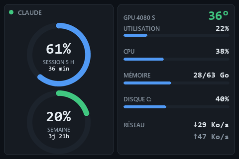

# Mini Monitor

*[English version](README.md)*

Un petit tableau de bord sobre pour l'écran USB de 3,5" vendu sous les noms **Turing Smart
Screen** ou **UsbMonitor**, écrit pour remplacer le logiciel du fabricant. À gauche, la
**consommation de ton abonnement Claude** ; à droite, le PC.



- **Claude en vedette.** Deux anneaux pour la session de 5 h et la semaine, avec le temps restant
  avant chaque remise à zéro. Ambre dès 75 %, rouge dès 90 %.
- **Le PC d'un coup d'œil.** Température et charge de la carte graphique (NVIDIA), processeur,
  mémoire, disque C: et réseau, chacun avec une fine barre. Les valeurs glissent vers chaque
  nouvelle mesure au lieu de sauter.
- **Honnête.** Une valeur inconnue s'affiche « ? » en gris, jamais un chiffre périmé.
- **Léger.** Environ 2 % d'un cœur. Le lien USB est lent (1,2 s pour un écran complet) : l'image
  est dessinée en mémoire et seules les zones qui ont changé sont envoyées.
- **Deux langues.** Français par défaut, anglais avec `--lang en`.

## Matériel

Testé sur le Turing Smart Screen 3,5" vendu sous le nom *UsbMonitor* (USB `1A86:5722`, série
`USB35INCHIPSV2`), en paysage. Les autres tailles et révisions ne sont pas encore gérées.

## Prérequis

- Windows 10 ou 11 (les polices sont lues dans `C:\Windows\Fonts`).
- Python 3.11 ou plus récent.
- Pour la carte graphique : une carte NVIDIA et son pilote. Sinon la ligne affiche « ? ».
- Pour les anneaux Claude : un abonnement Claude connecté avec
  [Claude Code](https://claude.com/claude-code) (`claude auth login`). Les anneaux lisent le jeton
  que Claude Code range dans `~/.claude/.credentials.json`.

## Installer

```
py -3.11 -m venv .venv
.venv\Scripts\python -m pip install -r requirements.txt
```

## Lancer

Ferme d'abord le logiciel du fabricant : un seul programme peut parler à l'écran à la fois.

```
.venv\Scripts\python -m minimonitor
```

| Option | Effet |
|---|---|
| `--lang fr\|en` | langue de l'écran (`fr` par défaut) |
| `--brightness 0-100` | rétroéclairage (60 par défaut) |
| `--port COM3` | port série (détecté par défaut) |
| `--preview image.png` | dessine une image avec les vraies données, sans l'écran |

## Vie privée

La seule requête réseau est `GET https://api.anthropic.com/api/oauth/usage`, toutes les 5 minutes,
avec ton jeton Claude. Le jeton n'est jamais affiché, journalisé ni écrit. Cette adresse est celle
qu'utilise Claude Code ; elle n'est pas documentée et peut changer : les anneaux afficheraient
alors « ? ».

Mini Monitor ne fait que lire le jeton. S'il expire, reconnecte-toi avec Claude Code (le
renouvellement automatique est prévu).

## Vérifier

```
powershell -ExecutionPolicy Bypass -File check.ps1
```

Affiche `CHECK OK` si tout va bien.

## Crédits et licence

Le protocole série de l'écran vient de
[turing-smart-screen-python](https://github.com/mathoudebine/turing-smart-screen-python), de
Matthieu Houdebine (GPL-3.0) ; Mini Monitor utilise son propre petit pilote. Licence
[GPL-3.0 ou ultérieure](LICENSE).
