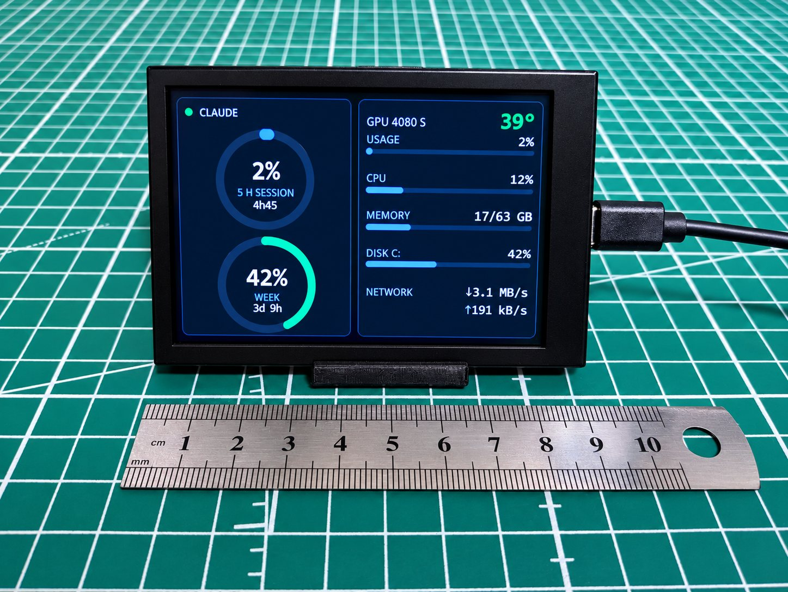
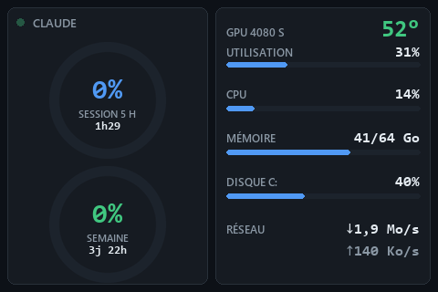

# Mini Monitor

*[English version](README.md) · [Site](https://mickaelmancini.com/mini-monitor/) · [Nouveautés](CHANGELOG.md) (en anglais)*

Un petit tableau de bord sobre pour les écrans USB bon marché vendus sous les noms **Turing Smart
Screen**, **UsbMonitor**, **XuanFang**, **Kipye** ou **WeAct**, écrit pour remplacer le logiciel du
fabricant, sous Windows et Linux. Pas d'écran ? Il tourne aussi dans une fenêtre sur le bureau.
D'un côté, la **consommation de ton abonnement Claude** ; de l'autre, le PC.





- **Claude en vedette.** Deux anneaux pour la session de 5 h et la semaine, avec le temps restant
  avant chaque remise à zéro. Ambre dès 75 %, rouge dès 90 %.
- **Le PC d'un coup d'œil.** Température et charge de la carte graphique, processeur, mémoire,
  disque et réseau, chacun avec une fine barre. Les valeurs glissent vers chaque nouvelle mesure
  au lieu de sauter.
- **Honnête.** Une valeur inconnue s'affiche « ? » en gris, jamais un chiffre périmé.
- **Toutes tailles, dans les deux sens.** La mise en page est redessinée nette à la résolution de
  l'écran, en paysage ou en portrait (Claude en haut), et tient dans le cercle d'un écran rond.
- **Léger.** Environ 2 % d'un cœur. Le lien USB est lent (1,2 s pour une image complète en 3,5") :
  l'image est dessinée en mémoire et seules les zones qui ont changé sont envoyées.
- **Deux langues.** Français par défaut, anglais avec `--lang en`.

## Écrans

| Écran | `--screen` | État |
|---|---|---|
| Turing Smart Screen 3,5", UsbMonitor 3,5" / 5" / 7" (révision A) | `turing-3.5` | **testé** (UsbMonitor 3,5") |
| XuanFang 3,5", y compris flagship (révision B) | `xuanfang-3.5` | non testé |
| Turing Smart Screen 2,1" rond (révision C) | `turing-2.1` | non testé |
| Turing Smart Screen 5" (révision C) | `turing-5` | non testé |
| Turing Smart Screen 8,8" (révision C) | `turing-8.8` | non testé |
| Kipye Qiye Smart Display 3,5" (révision D) | `kipye-3.5` | non testé |
| WeAct Studio Display FS V1 3,5" | `weact-3.5` | non testé |
| Une fenêtre sur le bureau | `window` | testé (Windows) |

L'écran est reconnu à son identité USB ; `--list-screens` montre ce qui a été trouvé. Les pilotes
non testés sont portés de
[turing-smart-screen-python](https://github.com/mathoudebine/turing-smart-screen-python), et les
tests vérifient qu'ils envoient exactement les mêmes octets que cette bibliothèque. Une fois
réveillés, les écrans de révision C ne disent pas leur taille : si un 2,1" ou un 8,8" est pris
pour un 5", précise-le avec `--screen`.

Si le tien marche (ou pas), ouvre une issue : le tableau le dira.

## Prérequis

- Windows 10 ou 11, ou Linux.
- Python 3.11 ou plus récent.
- Pour la carte graphique : une carte NVIDIA et son pilote (Windows et Linux), ou une carte AMD
  sous Linux (pilote `amdgpu`). Sinon la ligne affiche « ? ».
- Pour les anneaux Claude : un abonnement Claude connecté avec
  [Claude Code](https://claude.com/claude-code) (`claude auth login`). Les anneaux lisent le jeton
  que Claude Code range dans `~/.claude/.credentials.json` (ou dans `$CLAUDE_CONFIG_DIR`). Sous
  macOS, Claude Code le garde dans le trousseau : macOS n'est donc pas géré.
- Sous Linux, pour `--screen window` : Tk (`sudo apt install python3-tk` sur Debian et Ubuntu).

## Installer

[Télécharge Mini Monitor](https://mickaelmancini.com/mini-monitor/download) (archive ZIP du code,
toujours la dernière version), extrais-la et ouvre un terminal dans le dossier. Avec git :
`git clone https://github.com/Chmyke/mini-monitor`. Puis, sous Windows :

```
py -3.11 -m venv .venv
.venv\Scripts\python -m pip install -r requirements.txt
```

Linux :

```
python3 -m venv .venv
.venv/bin/python -m pip install -r requirements.txt
```

Pour utiliser l'écran sans être root, installe une fois la règle udev (elle tient aussi
ModemManager à l'écart de l'écran), puis rebranche l'écran :

```
sudo cp contrib/70-minimonitor.rules /etc/udev/rules.d/
sudo udevadm control --reload && sudo udevadm trigger
```

## Lancer

Ferme d'abord le logiciel du fabricant : un seul programme peut parler à l'écran à la fois.

```
.venv\Scripts\python -m minimonitor
```

(`.venv/bin/python` sous Linux.)

| Option | Effet |
|---|---|
| `--screen MODÈLE` | modèle d'écran, voir le tableau plus haut (détecté par défaut) |
| `--screen window` | affiche le tableau de bord dans une fenêtre au lieu d'un écran USB |
| `--portrait` | écran posé debout : Claude en haut, le PC en dessous |
| `--flip` | image à l'envers (écran monté dans l'autre sens) |
| `--port COM3` | port série, par exemple `/dev/ttyACM0` sous Linux (détecté par défaut) |
| `--list-screens` | liste les ports série et les écrans reconnus, puis s'arrête |
| `--lang fr\|en` | langue de l'écran (`fr` par défaut) |
| `--brightness 0-100` | rétroéclairage (60 par défaut) |
| `--disk CHEMIN` | disque affiché (`C:\` sous Windows, `/` sous Linux par défaut) |
| `--size 800x480` | taille de la fenêtre, de l'aperçu ou de la démo (480x320 par défaut) |
| `--preview image.png` | dessine une image avec les vraies données, sans l'écran |
| `--demo dossier` | écrit l'image et l'animation de démonstration (valeurs inventées) |

Ctrl+C pour l'arrêter.

## Démarrer avec Windows

```
powershell -ExecutionPolicy Bypass -File install-startup.ps1
```

Ce script crée une tâche planifiée, *Mini Monitor*, lancée à l'ouverture de session, sans fenêtre
ni droits administrateur (options : `-Lang en`, `-Brightness 40`, `-Screen turing-5`, `-Portrait`,
`-Flip` ; `-Uninstall` la retire). Elle résiste au débranchement de l'écran, à une
réinitialisation USB et à la mise en veille : l'écran est rouvert toutes les quelques secondes
puis redessiné en entier. Une deuxième copie attend quelques secondes puis renonce, puisqu'un seul
programme peut parler à l'écran.

Le journal est dans `%LOCALAPPDATA%\MiniMonitor\minimonitor.log` (connexions, coupures,
renouvellements du jeton, images lentes ; jamais un jeton).

## Démarrer avec Linux

`contrib/minimonitor.service` est un service utilisateur systemd lancé avec ta session et relancé
s'il plante. Il attend le projet dans `~/mini-monitor` ; modifie `ExecStart` pour un autre
emplacement ou d'autres options.

```
mkdir -p ~/.config/systemd/user
cp contrib/minimonitor.service ~/.config/systemd/user/
systemctl --user daemon-reload && systemctl --user enable --now minimonitor
```

Le journal est dans `~/.local/state/minimonitor/minimonitor.log`.

## Vie privée

Toutes les 5 minutes, Mini Monitor envoie une requête, `GET https://api.anthropic.com/api/oauth/usage`,
avec ton jeton Claude. Peu avant son expiration, il le renouvelle comme le fait Claude Code
(`POST https://platform.claude.com/v1/oauth/token`) et réécrit les nouveaux jetons dans
`~/.claude/.credentials.json`, de façon atomique, lisible par toi seul, sans toucher au reste du
fichier. Les jetons ne sont jamais affichés ni journalisés. Rien d'autre ne sort du PC.

Ces adresses sont celles de Claude Code ; elles ne sont pas documentées et peuvent changer : les
anneaux afficheraient alors « ? ». Si le renouvellement lui-même expire, reconnecte-toi avec
`claude auth login`.

## Vérifier

```
powershell -ExecutionPolicy Bypass -File check.ps1
```

Affiche `CHECK OK` si tout va bien. Sous Linux : `.venv/bin/python -m pytest`. Les deux tournent à
chaque envoi sur GitHub (GitHub Actions).

## Crédits et licence

Les protocoles série des écrans viennent de
[turing-smart-screen-python](https://github.com/mathoudebine/turing-smart-screen-python), de
Matthieu Houdebine et ses contributeurs (GPL-3.0) ; Mini Monitor les porte dans ses propres petits
pilotes (`minimonitor/screens/`), chacun citant sa source. Couleurs : palette
[Shotoshot](https://github.com/Chmyke/shotoshot). Licence [GPL-3.0 ou ultérieure](LICENSE).
