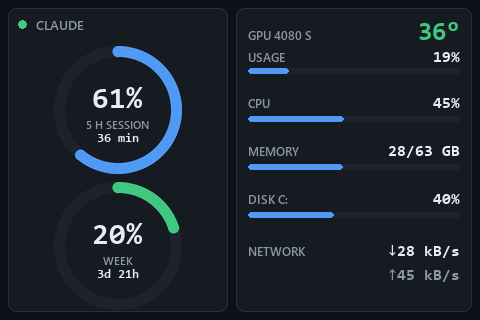

# Mini Monitor

*[Version française](README.fr.md)*

A small, quiet dashboard for the 3.5" USB screen sold as **Turing Smart Screen** or
**UsbMonitor**, written to replace the vendor software. The left half shows your **Claude plan
usage**; the right half shows the PC.



- **Claude first.** Two rings for the 5-hour session and the week, with the time left before each
  reset. Numbers turn amber from 75 % and red from 90 %.
- **The PC at a glance.** GPU temperature and load (NVIDIA), CPU, memory, disk C: and network,
  each with a thin bar. Values glide to each new sample instead of jumping.
- **Honest.** An unknown value is a grey `?`, never a stale number: if the usage request fails or
  a reset time has passed, the ring says so.
- **Light.** About 2 % of one CPU core. The USB link is slow (a full frame takes 1.2 s), so each
  frame is drawn in memory and only the rectangles that changed are sent.
- **Two languages.** French by default, English with `--lang en`.

## Hardware

Tested on the Turing Smart Screen 3.5" sold under the *UsbMonitor* name (USB `1A86:5722`,
serial `USB35INCHIPSV2`), in landscape. Other sizes and revisions are not supported yet.

## Requirements

- Windows 10 or 11 (the fonts are read from `C:\Windows\Fonts`).
- Python 3.11 or later.
- For the GPU row: an NVIDIA card and its driver. Without it the row shows `?`.
- For the Claude rings: a Claude subscription signed in with
  [Claude Code](https://claude.com/claude-code) (`claude auth login`) on the same account. The
  rings read the token Claude Code stores in `~/.claude/.credentials.json`.

## Install

```
py -3.11 -m venv .venv
.venv\Scripts\python -m pip install -r requirements.txt
```

## Run

Close the vendor software first: only one program can talk to the screen at a time.

```
.venv\Scripts\python -m minimonitor
```

| Option | Effect |
|---|---|
| `--lang fr\|en` | screen language (default `fr`) |
| `--brightness 0-100` | backlight (default 60) |
| `--port COM3` | serial port (default: detected) |
| `--preview file.png` | draw one frame with live data to a PNG, without the screen |

## Privacy

The only network request is `GET https://api.anthropic.com/api/oauth/usage`, every 5 minutes,
with your Claude token. The token is never printed, logged or written. This endpoint is the one
Claude Code uses; it is not documented and may change, in which case the rings show `?`.

Mini Monitor only reads the token. If it expires, sign in again with Claude Code
(automatic renewal is planned).

## Develop

One command checks everything (PowerShell scripts in ASCII, then the unit tests, which never
touch your real token nor the screen):

```
powershell -ExecutionPolicy Bypass -File check.ps1
```

## Credits

The serial protocol of the screen was learned from
[turing-smart-screen-python](https://github.com/mathoudebine/turing-smart-screen-python) by
Matthieu Houdebine (GPL-3.0). Mini Monitor uses its own small driver (`minimonitor/lcd.py`).
Colours come from the [Shotoshot](https://github.com/Chmyke/shotoshot) palette.

## License

[GPL-3.0-or-later](LICENSE).
