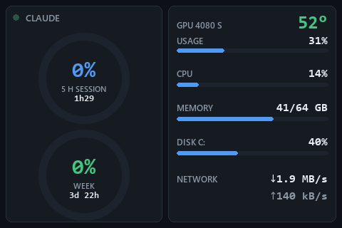

# Mini Monitor

*[Version française](README.fr.md) · [Website](https://mickaelmancini.com/mini-monitor/en/)*

A small, quiet dashboard for the cheap USB screens sold as **Turing Smart Screen**,
**UsbMonitor**, **XuanFang**, **Kipye** or **WeAct**, written to replace the vendor software, on
Windows and Linux. No screen? It also runs in a window on the desktop. One half shows your
**Claude plan usage**; the other half shows the PC.




- **Claude first.** Two rings for the 5-hour session and the week, with the time left before each
  reset. Numbers turn amber from 75 % and red from 90 %.
- **The PC at a glance.** GPU temperature and load, CPU, memory, disk and network, each with a
  thin bar. Values glide to each new sample instead of jumping.
- **Honest.** An unknown value is a grey `?`, never a stale number: if the usage request fails or
  a reset time has passed, the ring says so.
- **Any size, either way up.** The layout is redrawn sharp at the screen's own resolution, in
  landscape or in portrait (Claude on top), and fits inside the circle of a round screen.
- **Light.** About 2 % of one CPU core. The USB link is slow (a full 3.5" frame takes 1.2 s), so
  each frame is drawn in memory and only the rectangles that changed are sent.
- **Two languages.** French by default, English with `--lang en`.

## Screens

| Screen | `--screen` | Status |
|---|---|---|
| Turing Smart Screen 3.5", UsbMonitor 3.5" / 5" / 7" (revision A) | `turing-3.5` | **tested** (UsbMonitor 3.5") |
| XuanFang 3.5", including flagship (revision B) | `xuanfang-3.5` | untested |
| Turing Smart Screen 2.1" round (revision C) | `turing-2.1` | untested |
| Turing Smart Screen 5" (revision C) | `turing-5` | untested |
| Turing Smart Screen 8.8" (revision C) | `turing-8.8` | untested |
| Kipye Qiye Smart Display 3.5" (revision D) | `kipye-3.5` | untested |
| WeAct Studio Display FS V1 3.5" | `weact-3.5` | untested |
| A window on the desktop | `window` | tested (Windows) |

The screen is detected from its USB identity; `--list-screens` shows what was found. The
untested drivers are ported from
[turing-smart-screen-python](https://github.com/mathoudebine/turing-smart-screen-python), and the
tests check that they send exactly the same bytes as that library. Revision C screens cannot tell
their size apart once awake: if a 2.1" or 8.8" is taken for a 5", say so with `--screen`.

If yours works (or doesn't), please open an issue: the table will say so.

## Requirements

- Windows 10 or 11, or Linux.
- Python 3.11 or later.
- For the GPU row: an NVIDIA card and its driver (Windows and Linux), or an AMD card on Linux
  (`amdgpu` driver). Otherwise the row shows `?`.
- For the Claude rings: a Claude subscription signed in with
  [Claude Code](https://claude.com/claude-code) (`claude auth login`) on the same account. The
  rings read the token Claude Code stores in `~/.claude/.credentials.json` (or in
  `$CLAUDE_CONFIG_DIR`). On macOS Claude Code keeps it in the Keychain instead, so macOS is not
  supported.
- On Linux, for `--screen window`: Tk (`sudo apt install python3-tk` on Debian and Ubuntu).

## Install

Windows:

```
py -3.11 -m venv .venv
.venv\Scripts\python -m pip install -r requirements.txt
```

Linux:

```
python3 -m venv .venv
.venv/bin/python -m pip install -r requirements.txt
```

To use the screen without root, install the udev rule once (it also keeps ModemManager away from
the screen), then plug the screen back in:

```
sudo cp contrib/70-minimonitor.rules /etc/udev/rules.d/
sudo udevadm control --reload && sudo udevadm trigger
```

## Run

Close the vendor software first: only one program can talk to the screen at a time.

```
.venv\Scripts\python -m minimonitor
```

(`.venv/bin/python` on Linux.)

| Option | Effect |
|---|---|
| `--screen MODEL` | screen model, see the table above (default: detected) |
| `--screen window` | show the dashboard in a window instead of a USB screen |
| `--portrait` | screen standing upright: Claude on top, the PC below |
| `--flip` | picture upside down (screen mounted the other way) |
| `--port COM3` | serial port, e.g. `/dev/ttyACM0` on Linux (default: detected) |
| `--list-screens` | list the serial ports and the screens recognised, then exit |
| `--lang fr\|en` | screen language (default `fr`) |
| `--brightness 0-100` | backlight (default 60) |
| `--disk PATH` | disk to show (default `C:\` on Windows, `/` on Linux) |
| `--size 800x480` | size of the window, the preview or the demo (default 480x320) |
| `--preview file.png` | draw one frame with live data to a PNG, without the screen |
| `--demo folder` | write the demo picture and animation (made-up values) used here |

Stop it with Ctrl+C.

## Start with Windows

```
powershell -ExecutionPolicy Bypass -File install-startup.ps1
```

This registers a scheduled task, *Mini Monitor*, that starts at logon without a console window
and without administrator rights (options: `-Lang en`, `-Brightness 40`, `-Screen turing-5`,
`-Portrait`, `-Flip`; remove it with `-Uninstall`). It survives the screen being unplugged, a USB
reset or the PC going to sleep: the screen is reopened every few seconds and redrawn whole. A
second copy waits a few seconds, then gives up, since only one program can talk to the screen.

What happened is written to `%LOCALAPPDATA%\MiniMonitor\minimonitor.log` (connections, outages,
token renewals, slow frames; never a token).

## Start with Linux

`contrib/minimonitor.service` is a systemd user service that starts with your session and
restarts if it ever crashes. It expects the project in `~/mini-monitor`; edit `ExecStart` for
other places or options.

```
mkdir -p ~/.config/systemd/user
cp contrib/minimonitor.service ~/.config/systemd/user/
systemctl --user daemon-reload && systemctl --user enable --now minimonitor
```

The log is `~/.local/state/minimonitor/minimonitor.log`.

## Privacy

Every 5 minutes, Mini Monitor sends one request, `GET https://api.anthropic.com/api/oauth/usage`,
with your Claude token. Shortly before the token expires, it renews it the way Claude Code does
(`POST https://platform.claude.com/v1/oauth/token`) and writes the new tokens back to
`~/.claude/.credentials.json`, atomically, readable by you only, leaving every other entry of that
file untouched. Tokens are never printed nor logged. Nothing else leaves your PC.

These endpoints are the ones Claude Code uses; they are not documented and may change, in which
case the rings show `?`. If the renewal itself expires, sign in again with `claude auth login`.

## Develop

One command checks everything on Windows (PowerShell scripts in ASCII, then the unit tests, which
never touch your real token nor the screen):

```
powershell -ExecutionPolicy Bypass -File check.ps1
```

On Linux, `.venv/bin/python -m pytest`. Both run on every push (GitHub Actions).

## Credits

The serial protocols of the screens come from
[turing-smart-screen-python](https://github.com/mathoudebine/turing-smart-screen-python) by
Matthieu Houdebine and its contributors (GPL-3.0); Mini Monitor ports them into its own small
drivers (`minimonitor/screens/`), each crediting its source. Colours come from the
[Shotoshot](https://github.com/Chmyke/shotoshot) palette.

## License

[GPL-3.0-or-later](LICENSE).
